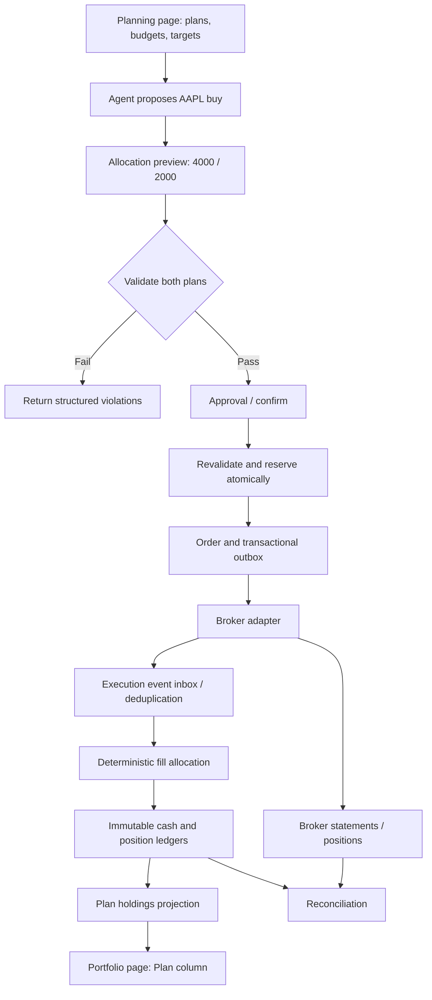

# Plan-Aware Trade Allocation — Implementation Specification for Coding LLM

## 0. Mission
Implement a production-oriented **plan-aware trade allocation** feature in an existing investment application. A planning page defines investment plans and target asset allocation. An AI agent can propose a trade, but a deterministic backend validates and allocates it. A portfolio page must show which plan owns each position, including the same security in multiple plans.

**Canonical scenario:** Plan-001 (Aggressive) has a $30,000 budget, targets 80% stocks / 20% bonds. Plan-002 (Conservative) has a $60,000 budget, targets 40% stocks / 60% bonds. An agent proposes BUY AAPL for $6,000, allocated $4,000 to Plan-001 and $2,000 to Plan-002. The allocation is a requested notional, not an executed position. Track actual fills, cash, reservations, and plan holdings.

**Assumptions:** Java 21 + Spring Boot + PostgreSQL backend and Angular frontend are suggested defaults, not requirements. Inspect the existing repository and reuse its language, frameworks, authentication, ORM, API conventions, broker adapter, and design system. Do not create a parallel architecture when existing services can be extended. Default to a modular monolith. Implement safe paper-trading or mock-broker flow first. Do not submit live orders unless the repository already supports live trading and the operator explicitly enables it.

## 1. Acceptance criteria
1. A user can create/edit two plans with budgets, asset-class targets, independent hard limits, status, and linked brokerage account(s).
2. Agent trade intent records security, side, notional, decision ID, proposed allocations, and immutable policy/version.
3. Preview validates each plan, returning eligibility, buying power, target-vs-hard-limit impact, violations, and any required approval. Preview never reserves funds.
4. Confirm revalidates current state, enforces authorization and idempotency, atomically persists plan allocations, reserves cash, and enqueues submission via transactional outbox.
5. If both plans use one compatible brokerage account, a broker order can be aggregated; if they use separate accounts, create separate broker orders. Never aggregate across accounts or currencies.
6. Broker fills are deduplicated, allocated deterministically, recorded in immutable ledger entries, and projected into plan positions.
7. Partial fills, cancellation, rejection, fees, fractional-share restrictions, corrections, and broker event replay are handled.
8. Portfolio page shows Plan column and supports All Plans, specific plan, and combined-symbol views. Two AAPL positions under different plans remain distinguishable.
9. Reconciliation checks broker executions, allocated quantities/gross/fees, broker positions, and cash against internal records; exceptions are visible and block unsafe trading.
10. Automated tests cover the scenarios and invariants below. Existing features and migrations remain compatible.

## 2. Functional model

### Plan definitions
| Field | Plan-001 | Plan-002 |
|---|---:|---:|
| Name | Aggressive Growth | Conservative Income |
| Budget / planned capital | $30,000 | $60,000 |
| Stock target | 80% ($24,000) | 40% ($24,000) |
| Bond target | 20% ($6,000) | 60% ($36,000) |
| Example AAPL trade intent | $4,000 | $2,000 |

Targets are desired weights, **not** hard maxima. Separate configurable concentration, asset-class, and cash constraints. Plan budget is not synonymous with deposited or available cash. Maintain a plan capital/cash ledger and reserved funds. Allow plans to share a brokerage account while retaining internal ownership allocations.

### Components and responsibilities
- **Planning Module:** Plan, asset-class target, risk profile, hard limits, account links, capital/funding events.
- **Agent/Strategy Module:** Produces proposal and rationale; does not directly update broker orders, positions, or ledgers.
- **Allocation Engine:** Validates proposed split, chooses plan participation, calculates deterministic execution allocation, supports pro-rata and precision rules.
- **Risk Engine:** Checks status, security eligibility, available buying power, hard exposure/concentration limits, broker restrictions, and approvals.
- **Order Management System:** Trade intent, allocation snapshot, orders, state machine, idempotency, submission outbox.
- **Broker Adapter:** Order submit/cancel/status, execution events, account balances, positions, fees, supported fractional increments; verify inbound event authenticity.
- **Ledger:** Immutable cash, reservation, position, fees, transfer, correction events; maintain projections.
- **Reconciliation:** Compare internal order/execution totals and account positions/cash with broker; flag exceptions.
- **Portfolio Query Module:** Plan-specific and consolidated holdings, market value, cost basis, performance, filters.

### Flow


## 3. Data model
Use `NUMERIC`/`BigDecimal` for money and quantities; explicit currency and instrument precision. Stable `instrument_id` is preferred over ticker as key (symbols change). Scope data by authenticated tenant/user and broker account.

| Table | Essential fields / constraints |
|---|---|
| `investment_plan` | id PK, tenant_id, name, risk_profile, planned_budget, currency, status, version |
| `plan_target_allocation` | plan_id FK, asset_class, target_pct, effective_from, version; sum active targets = 100% |
| `plan_risk_limit` | plan_id, limit_type, threshold, policy_version |
| `plan_account_link` | plan_id, broker_account_id, status, effective dates |
| `instrument` | id PK, symbol, asset_class, currency, tradability metadata, quantity_increment |
| `plan_capital_event` | id PK, plan_id, account_id, amount, currency, type, effective_at, reference_id |
| `trade_intent` | id PK, tenant_id, decision_id, instrument_id, side, requested_notional, currency, allocation_policy, policy_version, status, created_at; unique scoped decision/idempotency key |
| `trade_order` | id PK, trade_intent_id, broker_account_id, broker_order_id, side, status, requested_notional/quantity, created_at; unique scoped broker order id |
| `order_allocation` | id PK, order_id, plan_id, approved_notional, allocation_weight, allocation_priority, policy_snapshot, version; unique(order_id, plan_id) |
| `cash_reservation` | id PK, plan_id, order_id, reserved_amount, remaining_amount, currency, status; nonnegative remaining |
| `execution` | id PK, order_id, broker_id, broker_execution_id, quantity, price, gross_amount, fee, currency, executed_at, correction_reference; unique(broker_id, broker_execution_id) |
| `execution_allocation` | id PK, execution_id, order_allocation_id, quantity, gross_amount, allocated_fee; unique(execution_id, order_allocation_id) |
| `ledger_entry` | id PK, plan_id, account_id, instrument_id nullable, event_type, signed_cash, signed_quantity, cost_basis_delta, currency, source_event_id, created_at; immutable, balanced and replayable |
| `plan_position` | plan_id, account_id, instrument_id, quantity, cost_basis, updated_at; unique(plan_id, account_id, instrument_id); derived projection |
| `broker_event_inbox` | broker_id, external_event_id, payload, received_at, processing_status, unique(broker_id, external_event_id) |
| `outbox_event` | id, aggregate_id, event_type, payload, status, attempts, created_at |
| `reconciliation_run` | id, account_id, as_of, status, differences, started_at, completed_at |
| `plan_transfer` | id, source_plan_id, destination_plan_id, account_id, instrument_id, quantity, cost_basis, status, created_at; backed by offsetting ledger entries |

Relationship summary: Plan 1:N targets, capital events, order allocations, and positions. Intent 1:N orders; order 1:N allocations and executions; execution 1:N execution allocations; each execution allocation references one plan's order allocation. Brokerage account 1:N orders and plans (via link table). Instrument 1:N positions.

**Important:** The broker is the physical custodian; plans are logical sleeves. Reconcile summed plan positions plus any explicitly tracked unassigned positions to broker holdings. Never overwrite historical execution `plan_id` to move ownership; create audited transfer entries. If trades are placed in separate broker accounts, transfers may require actual broker activity.

## 4. Trade lifecycle and state machine
`DRAFT -> PREVIEWED -> APPROVED -> PENDING_SUBMISSION -> SUBMITTED -> PARTIALLY_FILLED -> FILLED`; also `REJECTED`, `CANCEL_PENDING`, `CANCELED`, `EXPIRED`, `RECONCILIATION_EXCEPTION`. Model order and intent status separately where appropriate. A canceled partially filled order retains its executed holdings. Do not assume broker submission succeeded merely because a network request timed out: query broker by client order ID before retrying. Use idempotent outbox dispatch.

### Phase A: preview
1. Validate authenticated tenant, agent authorization, instrument, currency, side, and positive amounts.
2. Verify allocation sum equals $6,000.00 exactly at currency precision; no duplicate plan IDs; plans active and linked to eligible account.
3. Lock-free read for preview only; report that preview is non-binding and can expire.
4. Check each plan's *actual* available cash = ledger cash - active reservations (with settlement/margin rules where relevant), estimated fees, buffer, target drift, and hard risk limits.
5. Return structured warnings/violations, projected allocation weights, and policy version.

### Phase B: confirmation
1. Require user/system approval as configured; enforce RBAC and account permissions.
2. Revalidate under transaction with deterministic lock ordering and concurrency control (optimistic version or appropriate row locks).
3. Reserve buying power for both plans and any shared broker-account-level buying-power constraints. Prevent double spending across concurrent requests.
4. Persist immutable intent snapshot, plan allocations, order(s), reservation(s), audit record, and transactional outbox event in one commit.
5. Submit asynchronously. Release/adjust reservations on rejection, cancellation, expiration, or completed execution.
6. If either plan fails and policy is `ALL_OR_NOTHING`, reject the entire trade; never silently reroute its allocation to another plan. Partial acceptance requires explicit configured approval.

### Phase C: fill processing
1. Verify webhook signature or broker transport trust; persist raw event to inbox and deduplicate.
2. Match broker order ID/client order ID and validate side, instrument, account, quantities, currency, and cumulative totals.
3. Allocate each incremental fill based on *cumulative* approved allocation proportions, respecting remaining approved notional and supported quantity increment. Use deterministic largest-remainder distribution of discrete quantity units; preserve previous allocations. If exact approved notional cannot be maintained because of price movement, follow a documented cap/exception policy rather than over-allocating.
4. Allocate fees in exact currency minor units by the same deterministic rule; the final recipient absorbs rounding remainder according to a stable tie-break rule.
5. In one transaction insert execution and execution allocations, post immutable cash/quantity/cost-basis ledger entries, update projections, adjust reservations, and emit portfolio update outbox event.
6. Handle corrections/busts via reversing entries referencing the original event. Reprocessing the same event is a no-op.

### Allocation mathematics
For approved notionals A1=4000 and A2=2000, weights are 2/3 and 1/3. For filled quantity Q, ideal cumulative plan quantity is `Q * weight`. Quantize to instrument's allowed quantity increment and distribute residual units by largest remainder, with stable tie-break by plan ID. Cumulative allocation must equal cumulative broker fills, and per-fill allocation must be nonnegative. Record fee allocation and gross amounts separately. Price-based notional limits require explicit tolerance and validation at execution time; do not claim a market order guarantees an exact $6,000 spend.

**Example:** AAPL $200/share, zero fees, 15 shares filled ($3,000): Plan-001 10 shares ($2,000), Plan-002 5 shares ($1,000). Remaining requested targets $2,000 and $1,000 respectively. A complete 30-share fill would allocate 20 and 10 shares. These are examples only, not real prices.

## 5. API contract (REST, `/api/v1`)
All APIs require authenticated authorization and tenant isolation. Document with OpenAPI. Use decimal values as **strings** in JSON to avoid client floating-point errors. Use consistent timestamps and error codes.

### POST `/trade-intents/preview`
Request:
```json
{
  "decisionId": "DEC-10045",
  "instrumentId": "US-AAPL",
  "symbol": "AAPL",
  "side": "BUY",
  "requestedNotional": "6000.00",
  "currency": "USD",
  "allocationPolicy": "PRO_RATA",
  "allocations": [
    {"planId": "PLAN-001", "notional": "4000.00"},
    {"planId": "PLAN-002", "notional": "2000.00"}
  ]
}
```
Response example (illustrative, conditional on real validation):
```json
{
  "previewId": "PREV-1001",
  "valid": true,
  "expiresAt": "2026-11-16T23:00:00Z",
  "allocationTotal": "6000.00",
  "policyVersion": 3,
  "allocations": [
    {"planId": "PLAN-001", "notional": "4000.00", "status": "VALID"},
    {"planId": "PLAN-002", "notional": "2000.00", "status": "VALID"}
  ],
  "violations": [],
  "warnings": []
}
```

### POST `/trade-intents`
Headers: `Idempotency-Key: DEC-10045-APPROVED`
```json
{
  "previewId": "PREV-1001",
  "decisionId": "DEC-10045",
  "approvalId": "APR-1001",
  "executionMode": "AGGREGATED",
  "expectedVersion": 3
}
```
Response `202 Accepted`:
```json
{
  "tradeIntentId": "TI-1001",
  "orderIds": ["ORD-1001"],
  "status": "PENDING_SUBMISSION",
  "requestedNotional": "6000.00",
  "allocationIds": ["ALLOC-001", "ALLOC-002"]
}
```
`AGGREGATED` is allowed only when account, currency, instrument, execution restrictions, and broker support permit. Otherwise use `PER_ACCOUNT` and return multiple orders.

### Broker event ingress (internal)
`POST /broker-events/executions` — not exposed to general users. Authenticate/verify broker. Example:
```json
{
  "brokerOrderId": "BRK-5001",
  "executionId": "EXEC-9001",
  "instrumentId": "US-AAPL",
  "side": "BUY",
  "filledQuantity": "15",
  "fillPrice": "200.00",
  "fees": "0.00",
  "currency": "USD",
  "executedAt": "2026-11-16T20:00:00Z"
}
```

### Query endpoints
- `GET /trade-intents/{id}` — intent, status, policy snapshot, approval.
- `GET /orders/{id}/executions` — raw fills and correction links.
- `GET /orders/{id}/allocations` — requested, executed, remaining per plan, fees.
- `POST /orders/{id}/cancel` — cancellation request, idempotent.
- `GET /plans/{id}/buying-power` — cash, reserved, unsettled, available.
- `GET /portfolio/holdings?groupBy=PLAN&planId=PLAN-001` — plan-specific positions; optional plan filter.
- `GET /portfolio/holdings?groupBy=INSTRUMENT` — aggregated across plans, with drilldown.
- `GET /portfolio/summary?planId=PLAN-001` — market value, asset mix, drift, P&L.
- `GET /reconciliations/{id}` — status and detailed discrepancies.
- `POST /plan-transfers` — audited internal reallocation with appropriate permissions.

Example `GET /portfolio/holdings?groupBy=PLAN` after the 15-share fill:
```json
{
  "positions": [
    {"planId": "PLAN-001", "instrumentId": "US-AAPL", "symbol": "AAPL", "quantity": "10", "costBasis": "2000.00"},
    {"planId": "PLAN-002", "instrumentId": "US-AAPL", "symbol": "AAPL", "quantity": "5", "costBasis": "1000.00"}
  ]
}
```

Use `400/422` for malformed/invalid input, `401/403` for authentication/authorization, `404` for unavailable resources, `409` for version/idempotency conflicts, and `202` for asynchronous submission. Structured error format: `code`, `message`, `planId` if applicable, `field`, `details`, `correlationId`.

## 6. Reconciliation
Per execution `e`:
- `sum(planAllocatedQuantity_e) == brokerExecutedQuantity_e`
- `sum(planAllocatedGross_e) == brokerGross_e` within explicit currency rounding rules
- `sum(planAllocatedFees_e) == brokerFees_e`

At account level compare: opening broker holdings + broker trades/corporate actions/transfers = ending broker holdings; sum plan-held + explicitly unassigned positions = broker ending holdings. Compare broker cash against aggregate internal cash, accounting for unsettled trades, funding, fees, dividends, and FX. Keep broker execution identity and immutable corrections. Flag `RECONCILIATION_EXCEPTION` and suspend unsafe automated trading when discrepancies affect buying power or positions. Expose exception detail to operations; do not silently alter history to force a match.

## 7. Angular UI requirements
### Planning page
- List/edit plans with ID, risk profile, budget, actual funded capital, stock/bond targets, hard limits, linked account, status.
- Show target vs actual asset mix, allocation drift, and available buying power.
- Targets are not displayed as invested holdings unless actual execution exists.

### Trade proposal / approval page
- Display agent decision, instrument, $6,000 total, Plan-001 $4,000, Plan-002 $2,000, pro-rata policy, per-plan cash and risk checks, warnings, and approval.
- Preview is non-binding. Confirmation uses idempotency key, shows pending/partial/filled/rejected statuses and fill-level allocation details.
- Never imply a trade executed until broker fills are confirmed.

### Portfolio page
- Add **Plan** column to position table. In plan grouping, show separate rows for AAPL under Plan-001 and Plan-002.
- Plan filter: All, Plan-001, Plan-002. Toggle combine same security across plans; combined row must support plan breakdown.
- Columns: symbol, asset class, plan ID/name, quantity, average cost, cost basis, current price, market value, unrealized P&L, last updated. Show cash separately.
- Example after 15 shares at $200: AAPL Plan-001 10 shares/$2,000 cost basis; AAPL Plan-002 5 shares/$1,000 cost basis.
- Clearly distinguish target allocation, approved order, executed shares, and current holdings.

## 8. Backend package outline
```text
com.investment.platform/
  planning/          PlanController, PlanService, PlanRepository
  allocation/        AllocationEngine, AllocationPolicy, ProRataAllocationPolicy, AllocationValidator
  risk/              RiskEngine, CashValidator, ExposureValidator
  trading/           TradeIntentController, OrderService, OrderStateMachine
  broker/            BrokerAdapter, BrokerEventHandler, ExecutionProcessor
  ledger/            CashLedgerService, PositionLedgerService, ReservationService
  reconciliation/    ReconciliationService, ReconciliationScheduler
  portfolio/         PortfolioController, PortfolioQueryService, HoldingsProjection
  common/            Auth, DecimalPolicy, ErrorHandling, Outbox, Idempotency
```
Prefer existing code structure over these illustrative names.

## 9. Algorithm pseudocode
```python
# Illustrative pseudocode, not drop-in executable implementation.
def confirm_trade(intent, idempotency_key):
    with database.transaction():
        if existing_result_for(idempotency_key):
            return existing_result_for(idempotency_key)
        plans = lock_plans_in_sorted_order(intent.plan_ids)
        account = lock_broker_account(intent.account_id)
        validate_allocations_sum(intent)
        for allocation in intent.allocations:
            validate_status_eligibility_risk_cash(plans[allocation.plan_id], allocation)
        order = persist_intent_order_and_allocation_snapshot(intent)
        reserve_plan_and_account_buying_power(order)
        persist_idempotency_result(idempotency_key, order)
        enqueue_outbox_event('SUBMIT_ORDER', order.id)
    return order

def process_execution(fill):
    with database.transaction():
        if already_processed(fill.broker_id, fill.execution_id):
            return
        order = lock_order(fill.order_id)
        verify_fill_belongs_to_order(fill, order)
        allocations = allocate_incremental_fill_using_cumulative_pro_rata(
            fill, order.approved_allocations, order.instrument.quantity_increment
        )
        assert sum(a.quantity for a in allocations) == fill.quantity
        save_raw_execution(fill)
        for a in allocations:
            post_immutable_execution_allocation_and_ledger_entries(a, fill)
        adjust_reservations_and_order_state(order)
        enqueue_outbox_event('PORTFOLIO_UPDATED', order.id)
```

## 10. Tests and edge cases
- Valid $6,000 allocation, 4000+2000; reject sum mismatch, negative values, duplicate plans, currency mismatch.
- Plan paused, instrument ineligible, hard max breached, insufficient buying power, missing approval.
- Concurrent orders competing for the same plan/account cash cannot both reserve beyond balance.
- Retry confirm with same idempotency key returns original result; same key with different body returns conflict.
- Broker 15 shares at $200 -> 10/5; 30 shares -> 20/10; multiple partial fills have same final cumulative allocation as a single fill, within share increment policy.
- Whole-share-only broker and odd fill quantity: deterministic rounding, no lost/created shares.
- Fractional increments and nonzero fees: exact quantity and fee reconciliation.
- Duplicate/out-of-order broker events, timeout after submission, cancellation after partial fill, rejection, fill bust/correction, price movement, stale preview.
- Shared account aggregate order vs separate-account order routing; never mix accounts.
- Plan transfer moves ownership via offsetting entries without rewriting historical executions.
- Rebuild `plan_position` from ledger and compare to materialized projection.
- UI: plan filter, combined holdings, Plan column, loading/error/empty states, approval and fill updates.
- Security: tenant isolation, authorization, webhook authentication, audit logs, no sensitive broker credentials in logs.

## 11. Delivery instructions for coding LLM
1. Inspect repository, identify existing entities, migrations, broker integration, order workflows, API patterns, Angular components, and tests.
2. Summarize current architecture and list files to modify. State assumptions and ask only truly blocking questions (especially shared vs separate brokerage account, fractional-share support, live vs paper mode).
3. Implement database migrations, domain entities, services, API DTOs/controllers, broker event ingestion, reconciliation, and Angular UI in incremental compilable steps.
4. Generate OpenAPI examples, automated tests, seed fixtures for Plan-001/Plan-002, and a README with local run/test instructions.
5. Run relevant tests and lint/build checks; report results, any unsupported broker capabilities, and remaining risks. Do not claim tests passed unless executed.
6. Never place live trades without explicitly enabled live-trading configuration and authorization; default to paper/mock broker.

## 12. Non-goals for first release
- Fully autonomous discretionary portfolio optimization.
- Tax-lot optimization, wash-sale logic, and advanced multi-currency accounting (unless already present; identify extension points).
- Cross-broker smart order routing.
- Guarantees of exact market-order notional execution.

## 13. Definition of done
A seeded paper-trading scenario demonstrates: create plans -> preview 4000/2000 -> validate/approve -> reserve -> submit mock broker order -> receive partial 15-share fill -> allocate 10/5 -> update immutable ledger and portfolio rows -> reconcile to 15 broker shares -> cancel remainder and release unused reservations. UI displays plan-specific AAPL rows and combined 15-share view. All automated invariants pass.
